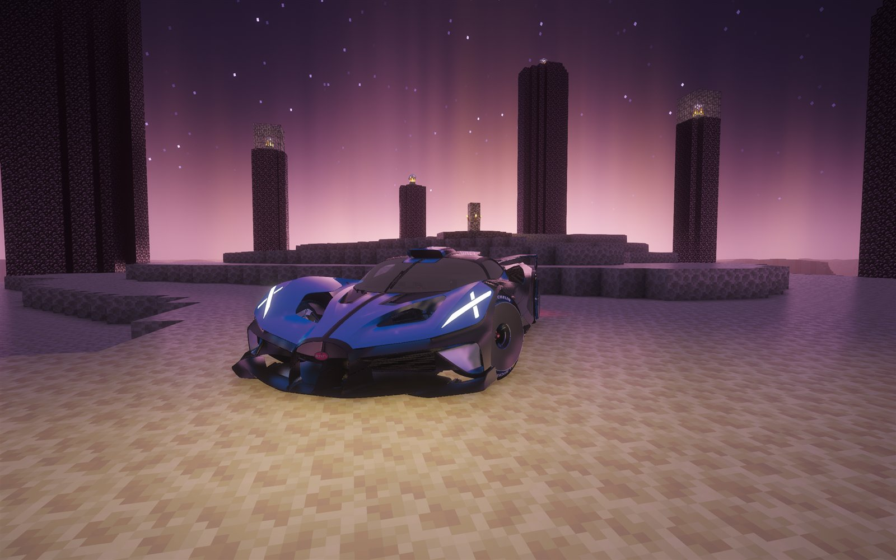

# Minecraft Dev Projects

Free vehicle mods for **Minecraft 1.21.11 (Fabric)**. Each mod is a separate jar; pick the ones you want.

Every mod needs [Fabric API](https://modrinth.com/mod/fabric-api) and [GeckoLib](https://modrinth.com/mod/geckolib). For the glossy paint, add [Iris](https://modrinth.com/mod/iris) with [Complementary Unbound](https://www.complementary.dev/shaders/).

## Cars

| | Vehicle | Download | 3D model |
|---|---|---|---|
|  | **Bugatti Bolide** | [1.0.0](https://github.com/cany38/Minecraft-Dev-Projects/releases/tag/bolide-v1.0.0) | Adapted from an Assetto Corsa community mod |

## Licence

The 3D models belong to their authors (see the table). Car and brand names belong to their owners. This is a non-commercial fan project.
