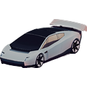
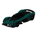
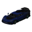
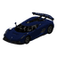

# Minecraft Hypercar Mods

Hyper realistic car mods for **Minecraft 1.21.11 (Fabric)**. There are blender minecraft edits at social media and here is their playable versions. Each mod is a separate jar, pick the ones you want.

Every mod needs [Fabric API](https://modrinth.com/mod/fabric-api) and [GeckoLib](https://modrinth.com/mod/geckolib). For ultra realistic texture, use [Iris](https://modrinth.com/mod/iris) with [Complementary Unbound](https://www.complementary.dev/shaders/) shader.

## Cars

| | Vehicle | Details |
|---|---|---|
|  | **Bugatti Bolide** |  |
|  | **Tesla Roadster** |  |
|  | **Aston Martin Valkyrie** |  |
|  | **Koenigsegg Agera RS** |  |
|  | **Mercedes AMG ONE** |  |
|  | **Ferrari LaFerrari** |  |
|  | **Bugatti Centodieci** |  |
|  | **Koenigsegg Jesko Attack** |  |

## Licence

All Rights Reserved. Free for personal play and social media videos/streams (with a link to this repo); selling, modifying, or re-uploading the jars without permission is not allowed. See [LICENSE](LICENSE.md) for full terms. Car and brand names belong to their owners; this is a non commercial fan project.
