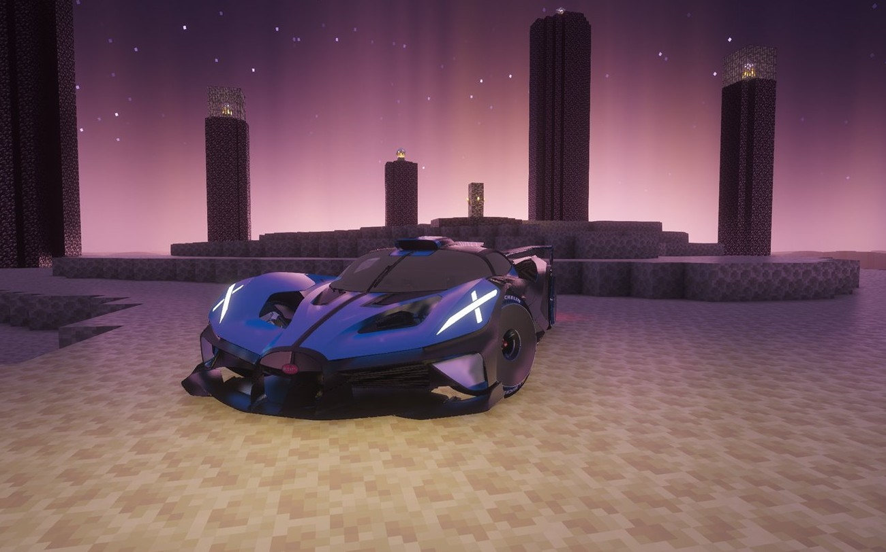
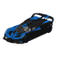

# Minecraft Dev Projects

Free vehicle mods for **Minecraft 1.21.11 (Fabric)**. Each mod is a separate jar; pick the ones you want.

Every mod needs [Fabric API](https://modrinth.com/mod/fabric-api) and [GeckoLib](https://modrinth.com/mod/geckolib). For ultra realistic texture, add [Iris](https://modrinth.com/mod/iris) with [Complementary Unbound](https://www.complementary.dev/shaders/).

## Cars

| | Vehicle | Download |
|---|---|---|
|  | **Bugatti Bolide** |  <a href="https://github.com/cany38/Minecraft-Dev-Projects/releases/tag/bolide-v1.0.0">Photos and details</a> |

## Licence

Car and brand names belong to their owners. This is a non commercial fan project.
